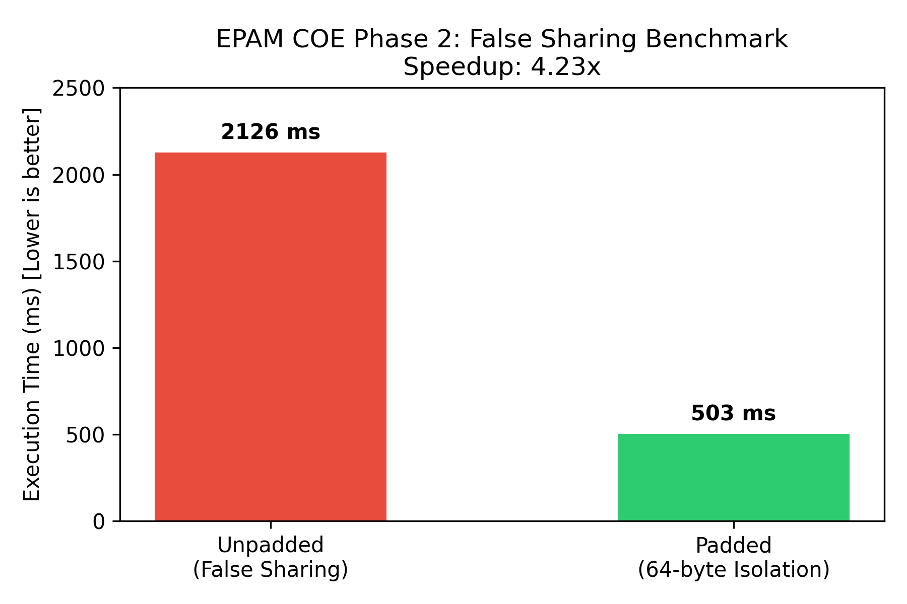

# Phase 2: Silicon Proof — False Sharing Benchmark

## 1. Hypothesis
When two threads concurrently mutate independent `volatile` variables situated on the same 64-byte CPU cache line, the hardware cache coherency protocol (MESI) repeatedly invalidates lines across cores (False Sharing). Applying 64-byte padding isolates each variable to distinct cache lines, eliminating interconnect bounce and drastically improving write throughput.

## 2. Test Environment
- **OS:** Windows 11
- **Logical Cores:** 8
- **Language / Runtime:** OpenJDK 21 (Temurin)

## 3. Benchmark Results

| Scenario | Execution Time (ms) | Throughput Speedup |
| :--- | :--- | :--- |
| **Unpadded (False Sharing)** | 2126 ms | 1.0x (Baseline) |
| **Padded (64-byte Padding)** | 503 ms | **4.23x Faster** |

### Visual Proof


## 4. How to Reproduce
```bash
javac src/FalseSharingDemo.java
java -cp src FalseSharingDemo
```
